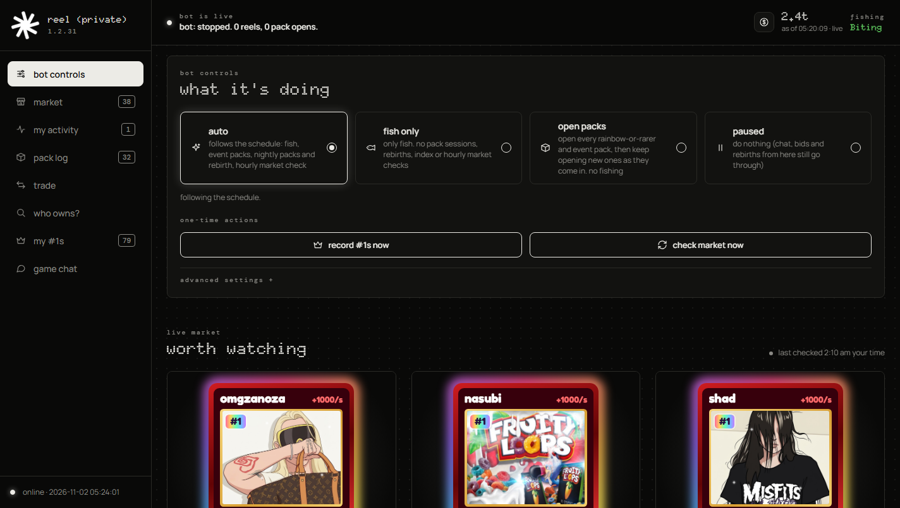
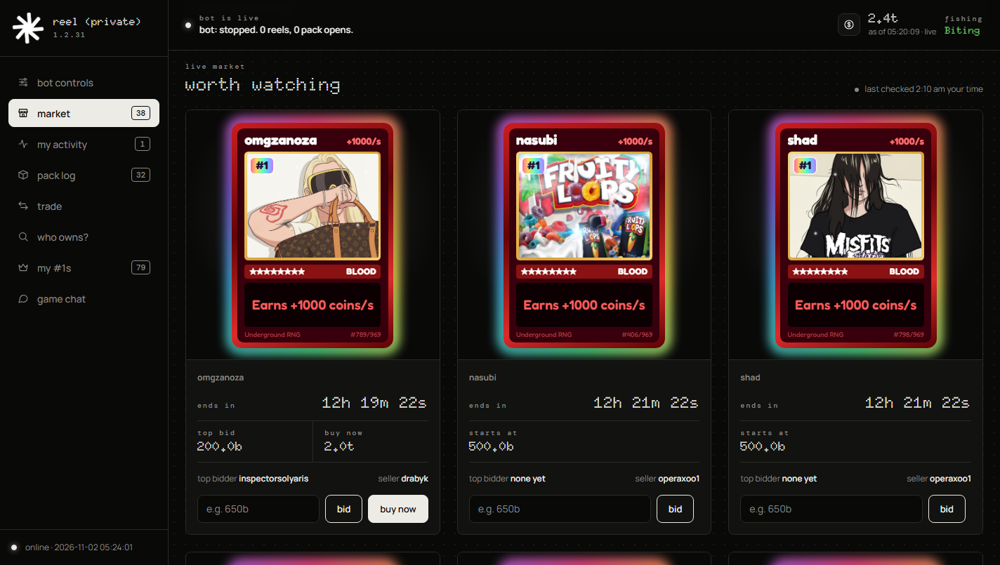
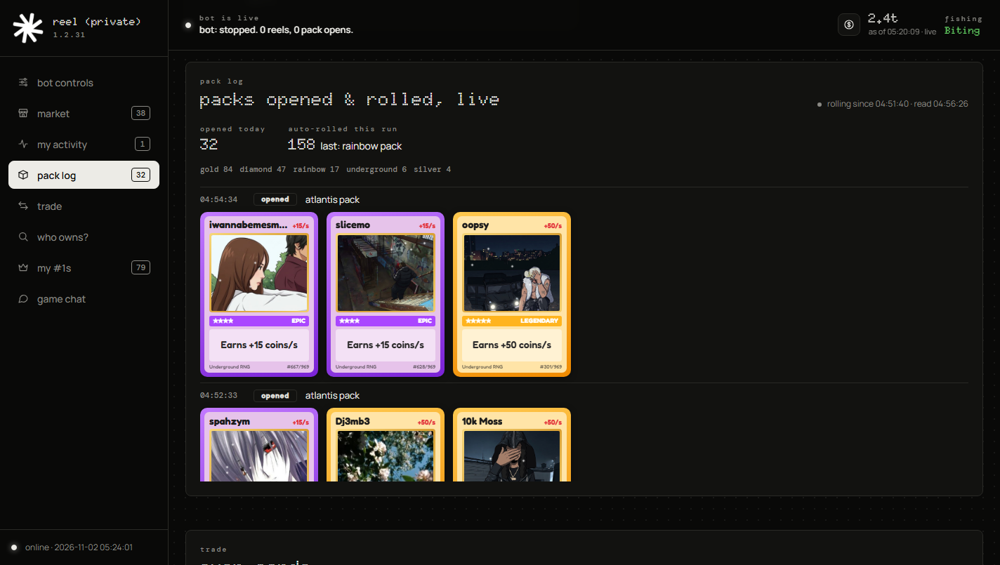
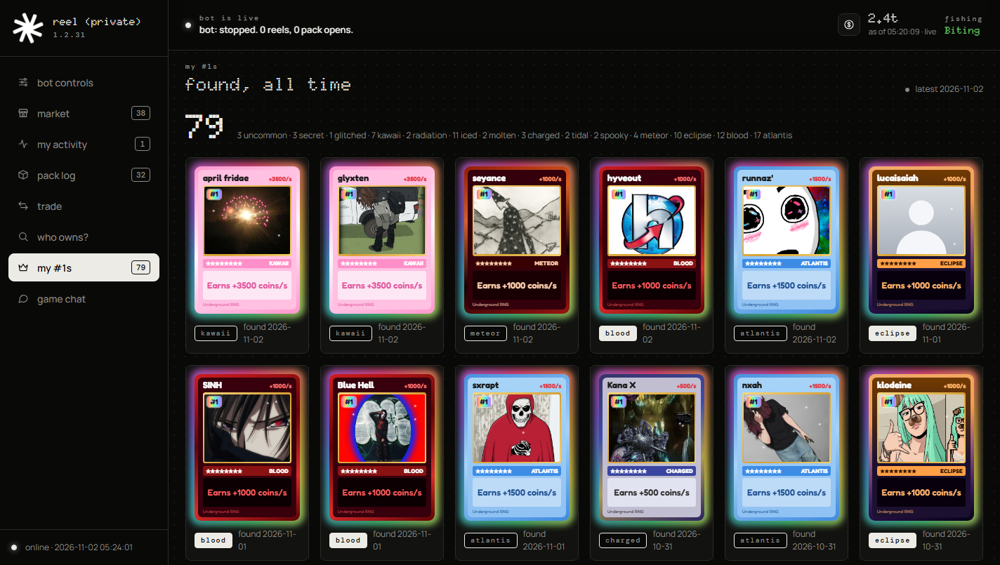

# reel

A bot for the Roblox game *Underground Artist RNG* (Windows only). It reads what the game shows
(menus, buttons, text, the reel, chat, card artwork) straight from the Roblox client's memory and
sends keyboard and mouse input. It never grabs the screen and never writes to the game's memory.

The website on your home network is reel (private). Every card is drawn from its own artwork.

**Use at your own risk.** Automating a Roblox game can break the game's or Roblox's rules and
can get an account banned.

## The website

Bot controls. Auto follows the schedule. Fish only just fishes. Open packs keeps opening packs.
Paused does nothing, though chat, bids and rebirths from the site still go through.



The live market: serial #1–#3 listings, with bid and buy now.



The pack log. Cards are shown full size, and clicking one opens a larger copy.



#1s found, all time.



The same site also has your listings and bids, the trade room (nothing there is automatic),
Who owns? with Join server, rebirth, and game chat (read and send). Outbid notices sit on top
of the page until you dismiss them.

## What it does

- Fishes nonstop (the reel's bar and fish read from memory, with the aim adjusted to the PC's
  input delay) and opens Atlantis packs from catch popups.
- Reads the event banner and opens event packs as they drop; records new #1 cards from the Index.
- Nightly (1–6 AM, in the PC's or a chosen timezone): opens every Rainbow-or-rarer and event pack,
  then rebirths with a share of your coins.
- Claims playtime gifts and the daily spin.
- Scans the Card Market for serial #1–#3 listings and places bids and buy-nows; notices the game's
  "You were outbid!" message.
- Trades, every step confirmed on the website: requests, both offers, adding, taking out and
  asking for single cards, coins, READY. The bot never completes a trade by itself.
- Opens Roblox, presses F11 so the game is fullscreen, and joins the game itself if it isn't
  running, and again if it closes.
- Updates itself from the newest GitHub release of this repo.

Bids, buys, rebirths, trades and chat from the website interrupt whatever the bot is doing, then
it carries on.

## Run it

The program is reel. The file is `UndergroundBot.exe`.

```
pip install -r requirements.txt
python main.py                     # bot + website
python main.py --dry-run-rebirth   # rebirths stop before the confirming click
python main.py --selftest          # checks the packaged pieces load (exit code 1 if not)
```

Or build a single `.exe` (no Python needed on the PC that runs it): `.\build_exe.ps1`, then
share `dist\UndergroundBot.exe`. A Python 3.12 venv with numpy 1.26 (`venv312\`) makes an .exe
that also starts on older PCs.

Settings are in `config.json`, created next to the program on first run (website, market
trips, nightly session hours, nightly rebirth share, auto-update, auto-launch...).
F8 (or creating `stop.flag`) stops the bot. Keep the PC awake.

The website is `http://<this PC>:8080`. It has no login. Keep it on your home network and don't
port-forward it.

## Layout

| | |
|---|---|
| `main.py` | the program: starts the website, the updater and the bot (`--selftest`) |
| `bot.py` | the schedule: fishing, events, nightly session, chores, and website requests |
| `memory_backend.py`, `mem_gui.py`, `mem_*.py`, `card_art.py` | reading the game from memory, finding buttons, card artwork |
| `game.py`, `ui_keys.py` | the Roblox window, mouse and keyboard input, typing |
| `fisher.py` | the reel minigame |
| `events.py`, `packs.py`, `packlog.py`, `index_check.py`, `ones.py` | events, opening packs, the pack log, #1s |
| `market.py`, `market_scan.py`, `mybids.py`, `whoowns.py`, `balance.py`, `outbid.py` | the Card Market |
| `trade.py`, `trade_flow.py` | the Trade window, and its link to the website |
| `chat.py`, `gifts.py`, `rebirth.py`, `launcher.py` | chat, gifts and daily spin, rebirths, starting Roblox |
| `config.py`, `paths.py`, `tz.py`, `webstate.py`, `cleanup.py`, `updater.py`, `version.py` | settings, files, clock, shared state, disk clean-up, self-update |
| `web/` | the website (`app.py` + `index.html`) |
| `tools/` | development helpers (memory probes, live tests, a website preview) |

## Notes

- Buttons are found in memory by what they say or are called, and clicked at their on-screen
  position as the game reports it, so a moved or restyled button is still found.
- Everything the bot writes (settings, state, card artwork, website data) goes next to the
  program, so it survives restarts. The bot and the website share small JSON files in
  `web/data/` under a cross-process lock.
